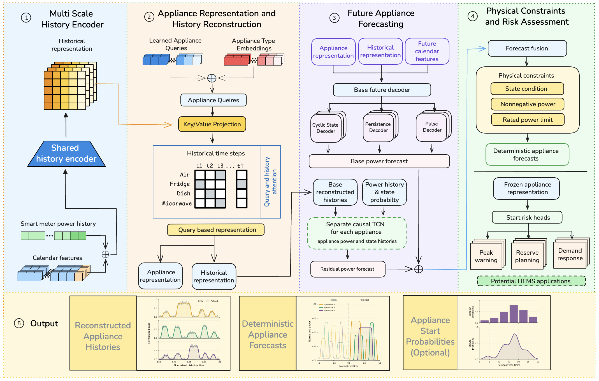
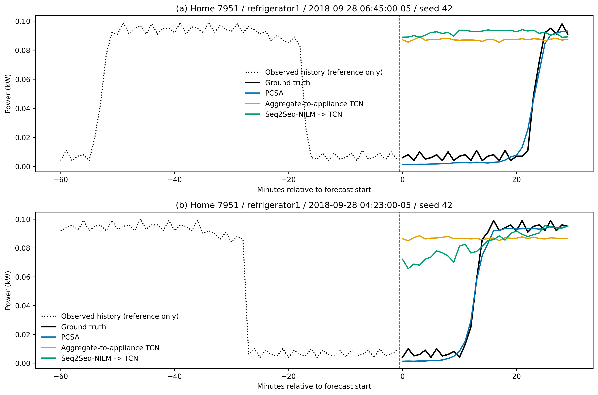

# PCSA: Constraint-aware appliance power forecasting

Research implementation for **PCSA: Constraint aware residential appliance power forecasting from smart meter histories**.

PCSA predicts the next **30 minutes** of appliance power from **120 minutes** of net-grid history and calendar features. It combines historical appliance reconstruction, appliance-conditioned forecasting and separate causal TCN residual corrections. Appliance measurements supervise training and adaptation; deployment uses net-grid and calendar inputs.

[Architecture](#architecture) · [Results](#results) · [Training and evaluation](docs/PCSA_GUIDE.md) · [Experiment records](records)

## Architecture



The evaluated pipeline contains four main operations:

1. Encode net-grid history and calendar information.
2. Reconstruct appliance power histories and estimate historical state probabilities.
3. Produce base forecasts, then apply appliance-specific causal TCN residual corrections.
4. Apply smooth empirical amplitude caps before soft state conditioning.

Training has two conceptual stages: historical pretraining, then forecasting. Within forecasting, the base is optimized before the residual branch, with the relevant preceding modules frozen. The maximum stage budgets are 160, 80 and 80 epochs. Each seed uses its own historical model.

The figure also illustrates optional start-risk and HEMS applications, which are outside the evaluated deterministic forecasting results. Its “rated power limit” label denotes the empirical caps used here, not manufacturer ratings. The evaluated model does not instantiate the historical refiner. The `pisa` name remains in Python modules for compatibility; the method is called **PCSA**.

## Results

September 2018 Pecan Street records cover source Home **7951** and target Homes **3039, 8386 and 8565**. Chronological splits use days 1–20 for training, 21–25 for validation and 26–30 for testing. Results below report mean ± sample standard deviation across seeds **7, 42 and 123**. Bold marks the lowest mean MAE; it does not denote statistical significance.

### Source-household forecasting

| Appliance | PCSA | Aggregate TCN | Seq2Seq-NILM–TCN |
|---|---:|---:|---:|
| Air conditioner | **0.230537 ± 0.016784** | 0.258668 ± 0.006960 | 0.239634 ± 0.015243 |
| Refrigerator | **0.025004 ± 0.002083** | 0.041669 ± 0.000072 | 0.029157 ± 0.000973 |
| Dishwasher | 0.013997 ± 0.001135 | **0.012811 ± 0.000084** | 0.016819 ± 0.003673 |
| Microwave | 0.018126 ± 0.000642 | 0.016501 ± 0.000335 | **0.016049 ± 0.000353** |
| Macro MAE | **0.071916 ± 0.003295** | 0.082412 ± 0.001770 | 0.075415 ± 0.004827 |

All errors are in kW. PCSA reduces mean source Macro MAE by **4.64%** relative to Seq2Seq-NILM–TCN and **12.74%** relative to Aggregate TCN. Performance varies by appliance; the improvement is not uniform across ON and OFF conditions.

### Cross-household forecasting

Support is the earliest chronological fraction of valid target **training windows**. Additional labeled validation data are used for model selection and are excluded from these percentages. All entries are test Macro MAE in kW.

| Target home | Support | PCSA | Aggregate TCN | Seq2Seq-NILM–TCN |
|---|---:|---:|---:|---:|
| 3039 | 0% | 0.279645 ± 0.006478 | **0.251807 ± 0.003699** | 0.275308 ± 0.017603 |
| 3039 | 1% | 0.270530 ± 0.009651 | **0.232160 ± 0.005611** | 0.252068 ± 0.018943 |
| 3039 | 5% | 0.240064 ± 0.021531 | **0.220328 ± 0.009786** | 0.225733 ± 0.011219 |
| 3039 | 10% | **0.211258 ± 0.026268** | 0.224009 ± 0.008885 | 0.235783 ± 0.031904 |
| 8386 | 0% | **0.033628 ± 0.000580** | 0.033996 ± 0.000232 | 0.034229 ± 0.000383 |
| 8386 | 1% | 0.032431 ± 0.000506 | **0.032023 ± 0.000256** | 0.032878 ± 0.000471 |
| 8386 | 5% | 0.032575 ± 0.000809 | **0.032327 ± 0.000215** | 0.032812 ± 0.000686 |
| 8386 | 10% | **0.031905 ± 0.000346** | 0.032292 ± 0.000241 | 0.032772 ± 0.000612 |
| 8565 | 0% | 0.307855 ± 0.033139 | 0.298188 ± 0.004129 | **0.222724 ± 0.056733** |
| 8565 | 1% | 0.299323 ± 0.032487 | 0.294263 ± 0.004110 | **0.193498 ± 0.083963** |
| 8565 | 5% | 0.267410 ± 0.024550 | 0.291440 ± 0.005520 | **0.179249 ± 0.022443** |
| 8565 | 10% | 0.227956 ± 0.006805 | 0.187184 ± 0.014565 | **0.161709 ± 0.013006** |

PCSA has the lowest mean MAE in **three of twelve** target settings. Seq2Seq-NILM–TCN leads throughout Home 8565. Different trainable scopes and supervision mean these rankings are not architecture-only comparisons.

### Component ablations

| Variant | Source test Macro MAE (kW) | Maximum pipeline epochs |
|---|---:|---:|
| Full PCSA | 0.071916 ± 0.003295 | 320 |
| Without residual correction | 0.074548 ± 0.002225 | 240 |
| Without future state gating | **0.071232 ± 0.001071** | 320 |

Residual correction improves mean error relative to its removal. Future state gating produces appliance-dependent ON/OFF tradeoffs rather than a uniform overall MAE gain. The no-gate variant retains state supervision, historical state inputs and residual fusion gates. The no-residual comparison uses a smaller training budget.

### Forecast examples



Selected seed-42 source-household examples illustrate local forecasting behavior. They were selected for PCSA window-MAE improvement over both baselines; overall performance is evaluated on the complete test set. Observed appliance histories are shown for reference and are not inference inputs.

## Training and evaluation

See the **[PCSA implementation guide](docs/PCSA_GUIDE.md)** for the code layout, data preparation, complete training sequence and result files. A CUDA-enabled PyTorch environment is required for the full experiments. Raw household data are obtained separately through Pecan Street Dataport; this repository contains no raw records or model weights.

## Scope and reproducibility

The public package reorganizes the evaluated implementation without changing model definitions, losses or data preparation. The original experiment manifest and a source migration map are retained in `records/`. Complete metrics, target-label budgets, training costs, checkpoint provenance and component diagnostics are provided in the [experiment records](records).

Source caps were chosen after inspection of the source month, including eventual test dates, and earlier test outputs were inspected during development. Net-grid filtering affects retained coverage. Results are a retrospective fixed-protocol comparison; event recognition and operational HEMS benefits are not established.

## Repository layout

```text
src/          Model architecture, data loaders and losses
training/     Training, evaluation and experiment protocol
scripts/      Data preparation and component ablations
records/      Paper results and reproducibility records
docs/         Setup, commands and provenance notes
figures/      Architecture and forecasting examples
archive/      Previous implementation, for historical reference
```

Run commands from the repository root. The current implementation is in `src/`, `training/` and `scripts/`. The previous implementation is isolated under `archive/previous_implementation/` and is not imported by the current workflow.

Use the repository homepage for the project and the [`paper-results` tag](https://github.com/yeuse/pcsa_appliance_forecasting/tree/paper-results) to identify the published code layout. See [provenance notes](docs/PROVENANCE.md) for the relationship between this package and the original experiment snapshot.
